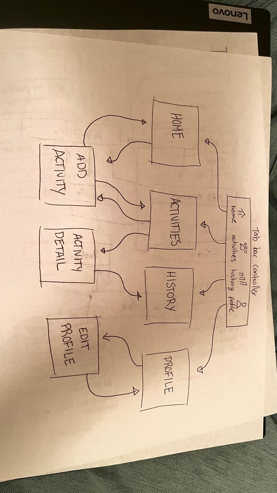
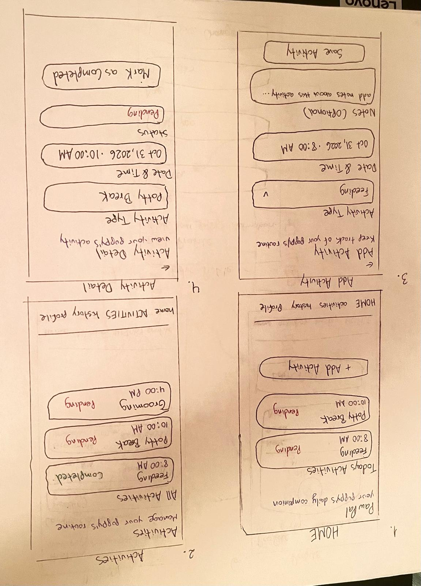
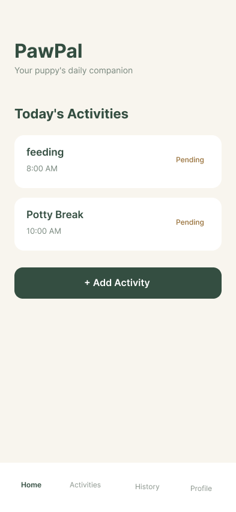
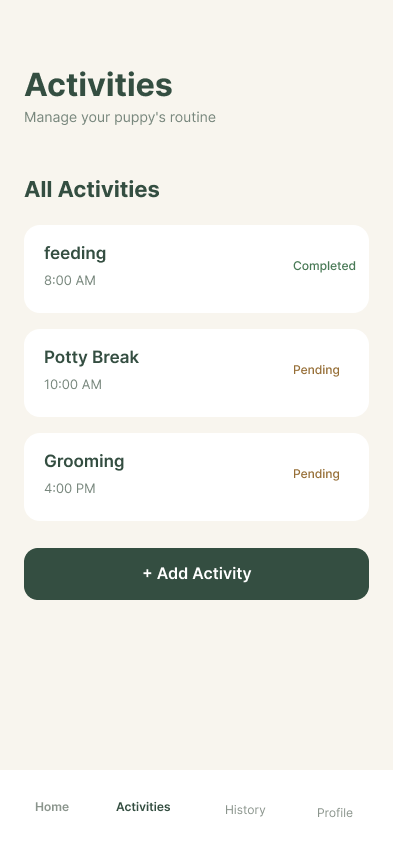
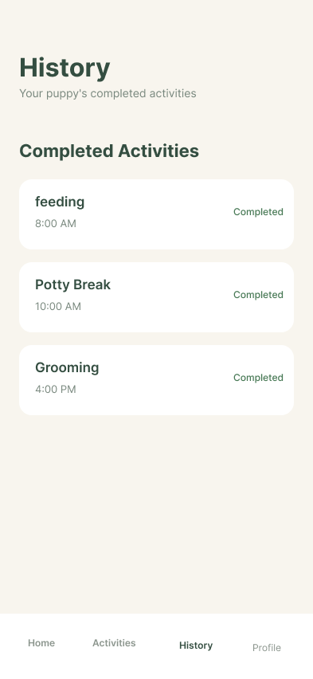
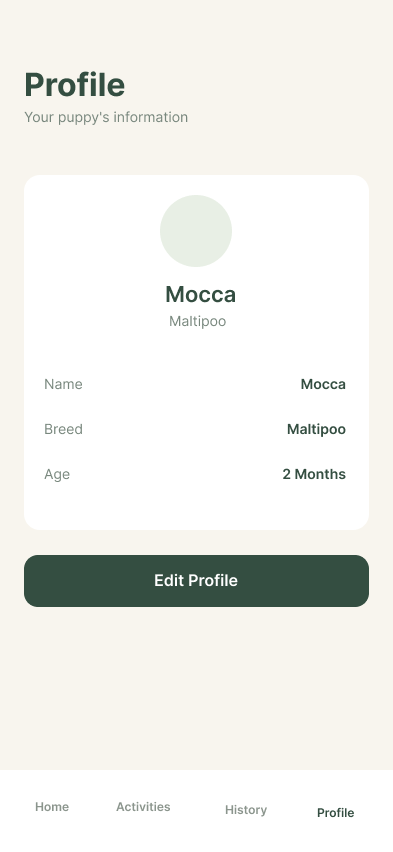

# PawPal

## Table of Contents

1. [Overview](#Overview)
2. [Product Spec](#Product-Spec)
3. [Wireframes](#Wireframes)
4. [Development Progress](#Development-Progress)
5. [Schema](#Schema)
6. [Demo](#Demo)

## Overview

### Description

PawPal is an iOS application designed to help new puppy owners organize and track their pets' daily routines. Raising a puppy involves managing several responsibilities, including feeding, potty breaks, grooming, and other care activities. PawPal provides a simple and convenient way to keep track of these tasks in one place.

The app allows users to create a profile for their puppy, add daily care activities, mark tasks as completed, and review their activity history. PawPal aims to make puppy care more organized, especially for first-time pet owners who are still learning how to establish a consistent routine.

### App Evaluation

- **Category:** Lifestyle / Pet Care
- **Mobile:** PawPal is designed for mobile devices because puppy owners often need to record activities throughout the day. Users can quickly log care tasks from their phones, with optional features such as photo selection and notifications.
- **Story:** New puppy owners may struggle to remember feeding times, potty breaks, grooming activities, and other responsibilities. PawPal helps them organize this information and maintain a more consistent care routine.
- **Market:** The target audience includes first-time puppy owners, households with young dogs, and pet owners who want a simple way to organize their puppies' daily care.
- **Habit:** Users can interact with PawPal several times per day to check upcoming activities, record completed tasks, and review their puppy's routine.
- **Scope:** The initial version focuses on creating a puppy profile, tracking daily activities, marking tasks as completed, and viewing activity history. Additional features include photo selection, weight tracking, local notifications, and sharing care information.

## Product Spec

### 1. User Stories (Required and Optional)

**Required Must Have Stories**

- [x] User can create and edit a puppy profile with basic information such as name, age, and breed.
- [x] User can view a list of daily puppy care activities.
- [x] User can add a new activity by selecting a category, date, and time.
- [x] User can mark an activity as completed.
- [x] User can view a history of completed activities.

**Optional Nice to Have Stories**

- [ ] User can upload a profile picture of their puppy from the photo library. (Implemented; photo selection testing pending.)
- [ ] User can receive notifications reminding them of scheduled activities. (Implemented; notification delivery testing pending.)
- [x] User can track their puppy's weight over time.
- [x] User can share their puppy's care information with another caregiver using the iOS share sheet.

### 2. Screen Archetypes

**Home Screen**
- User can view today's puppy care activities.
- User can see which activities are pending or completed.
- User can select an activity to view its details.
- User can navigate to the Add Activity screen.

**Activities Screen**
- User can view all puppy care activities.
- User can select an activity to view its details.
- User can navigate to the Add Activity screen.

**Add Activity Screen**
- User can select an activity category, such as feeding, potty breaks, or grooming.
- User can choose a date and time.
- User can add optional notes and save the activity.
- User can enable a reminder for a future activity.

**Activity Detail Screen**
- User can view information about a selected activity.
- User can mark an activity as completed or pending.
- User can delete an activity.
- Pending reminders are canceled when an activity is completed or deleted.

**History Screen**
- User can view previously completed activities.
- User can select an activity to view its details.

**Profile Screen**
- User can view their puppy's profile information.
- User can view the puppy's saved profile photo.
- User can navigate to the Edit Profile screen.
- User can access Weight Tracking.
- User can access Share Care Info.

**Edit Profile Screen**
- User can enter or update their puppy's name, age, and breed.
- User can save profile changes.
- User can select or remove a puppy profile photo.

**Weight Tracking Screen**
- User can record their puppy's weight and date.
- User can view the latest recorded weight.
- User can view weight history and a growth chart.
- User can delete weight records.

**Share Care Info Screen**
- User can view a summary of puppy care information.
- User can share profile information, the latest weight, and recent activities using the native iOS share sheet.

### 3. Navigation

**Tab Navigation** (Tab to Screen)

- Home
- Activities
- History
- Profile

**Flow Navigation** (Screen to Screen)

- Home → Add Activity
- Home → Activity Detail
- Home → Activities, History, or Profile using the bottom navigation bar
- Activities → Activity Detail
- Activities → Add Activity
- Add Activity → Previous screen after saving an activity
- Activity Detail → Previous screen after marking an activity as completed or pending
- History → Activity Detail
- Profile → Edit Profile
- Edit Profile → Profile after saving changes or using the back button
- Profile → Weight Tracking
- Profile → Share Care Info

## Wireframes

The following hand-drawn low-fidelity wireframes illustrate PawPal's seven original main screens, their key interface elements, and the navigation flow between screens.

The sketches show the basic layouts for Home, Activities, Add Activity, Activity Detail, History, Profile, and Edit Profile. The navigation diagram illustrates how users move between the main tabs and secondary screens.

**Hand-Drawn Wireframes**

**Navigation Flow Diagram**

### [BONUS] Digital Wireframes & Mockups

We created seven digital mockups in Figma to visualize PawPal's user interface. The designs use a consistent color palette, activity cards, simple forms, and a bottom navigation bar to make daily puppy care easy to manage.

**Home Screen**

**Activities Screen**

**Add Activity Screen**

**Activity Detail Screen**

**History Screen**

**Profile Screen**

**Edit Profile Screen**

### [BONUS] Interactive Prototype

We created an interactive prototype in Figma to demonstrate how users would navigate through PawPal and interact with its main features.

The prototype demonstrates:

- Navigating between Home, Activities, History, and Profile using the bottom tab bar.
- Opening the Add Activity form and returning to the previous screen after saving.
- Selecting an activity to view its details.
- Marking an activity as completed and navigating to History.
- Opening Edit Profile and returning to Profile after saving changes.
- Using back buttons to return to previous screens.

**Prototype Video**

[Watch the PawPal Interactive Prototype](https://youtube.com/shorts/56_4BqYvuUc?feature=share)

The interactive prototype demonstrates the intended user experience. Unlike the Figma prototype, the current SwiftUI implementation supports real user input and local data storage.

## Development Progress

### Technology Stack

- **Language:** Swift
- **Framework:** SwiftUI
- **Development Environment:** Xcode
- **Local Storage:** UserDefaults with Codable
- **Photo Selection:** PhotosUI / PhotosPicker
- **Growth Charts:** Swift Charts
- **Local Reminders:** UserNotifications
- **Sharing:** SwiftUI ShareLink
- **Version Control:** Git and GitHub

### Sprint 1 - Core App Features

Implemented the primary app navigation and core puppy care features.

- Main navigation with four tabs
- Puppy profile creation and editing
- Activity creation and local storage
- Activity detail screen
- Activity completion tracking
- Completed activity history

### Sprint 2 - Optional Features

Implemented additional functionality to support puppy care management.

- Puppy profile photo selection and local photo storage
- Weight tracking with a growth chart
- Local activity reminders
- Reminder cancellation when an activity is completed or deleted
- Sharing puppy care information using ShareLink

Photo selection with an imported image and notification delivery still require additional testing.

### Sprint 3 - Testing and Final Improvements

Planned work includes:

- Testing all features and correcting bugs
- Verifying photo selection and notification delivery
- Verifying local data persistence after restarting the application
- Reviewing the interface against the original Figma designs
- Improving usability and accessibility
- Updating documentation and preparing the final app demonstration

### Project Management

The development process is organized using GitHub Issues, a Project Board, and three sprint milestones.

**GitHub Project Board:**

[PawPal - Capstone Development](https://github.com/orgs/PawPal-COP4655/projects/1)

**Sprint Milestones:**

- Sprint 1 - Core App Features
- Sprint 2 - Optional Features
- Sprint 3 - Testing and Final Improvements

Development issues are organized into Todo, In Progress, and Done to track completed work, ongoing development, and planned improvements.

## Schema

### Models

**PuppyProfile**

Stores the puppy's basic information.

- `name`: String
- `breed`: String
- `ageInMonths`: Int

**CareActivity**

Stores information about a puppy care activity.

- `id`: UUID
- `category`: ActivityCategory
- `date`: Date
- `notes`: String
- `isCompleted`: Bool
- `completedAt`: Optional Date

**ActivityCategory**

Defines the supported activity categories.

- Feeding
- Potty Break
- Grooming
- Playtime
- Medication
- Other

**WeightRecord**

Stores puppy weight measurements.

- `id`: UUID
- `date`: Date
- `weightInPounds`: Double

**PawPalStore**

An ObservableObject responsible for managing:

- Puppy profile information
- Care activities
- Weight records
- Local data persistence

The app saves the puppy profile, activities, and weight records using Codable and UserDefaults. Profile photo data is stored locally using AppStorage.

### Networking

The current version of PawPal works locally and does not require a networking service or external database.

Notifications are scheduled locally on the device. Care information can be shared through the native iOS share sheet, but live synchronization between caregivers is not currently supported.

## Demo

### Milestone 1 - Interactive Prototype

The original interactive Figma prototype demonstrates the planned design and navigation of PawPal.

[Watch the PawPal Interactive Prototype](https://youtube.com/shorts/56_4BqYvuUc?feature=share)

### Milestone 2 - SwiftUI Development Progress

The following video demonstrates the current implementation of PawPal using SwiftUI in the iOS simulator.

**App Demo Video:**

[Watch PawPal - Milestone 2 Demo](https://youtu.be/r7QTv-pWSVs)

The demonstrated development includes:

- Navigating between the main app screens
- Creating and editing a puppy profile
- Adding puppy care activities
- Marking activities as completed
- Viewing completed activity history
- Tracking puppy weight
- Viewing care information sharing
- Accessing the activity reminder feature

The video provides evidence of the application's development progress. Additional testing and improvements are planned for Sprint 3.
